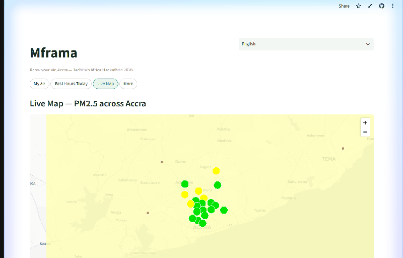

# Mframa — Know your air, Accra

[](https://mframa.streamlit.app)
[](https://api.openaq.org)
[](dist/Mframa-v0.8-debug.apk)
[](LICENSE)

*Mframa* means "air" in Twi. Most air-quality apps show you pollution. Mframa is built to protect a specific person: it tells a mother in Nima when to open her windows, a cyclist in Osu which hours to avoid, and a market trader at Agbogbloshie what yesterday's air actually did to her lungs. Bilingual English/中文, phone-first, no account needed.

Built for the **TechHub Africa Hackathon 2026**, track *Reducing Public Pollution*.

- **Live app:** [mframa.streamlit.app](https://mframa.streamlit.app) (Streamlit Community Cloud)
- **Repo:** [github.com/qsxcv20/mframa](https://github.com/qsxcv20/mframa) · entry point `app.py`
- **Android companion:** prebuilt APK at [`dist/Mframa-v0.8-debug.apk`](dist/Mframa-v0.8-debug.apk)

## Three numbers

| Number | Source |
|---|---|
| **~28,000 premature deaths per year** in Ghana from air pollution (WHO 2020) | [Clean Air Fund — Ghana](https://www.cleanairfund.org/geography/ghana/) |
| Ghana's 2019 annual PM2.5 was **11× the WHO 2021 guideline**; air pollution is the country's **second-largest health risk factor**, after malnutrition | [Clean Air Fund — Ghana](https://www.cleanairfund.org/geography/ghana/) |
| Nowcast backtest **MAE 4.14 µg/m³ vs 5.89 for persistence** (~30% better); accuracy 0.7049 vs an oracle ceiling of 0.71 | [`bench_nowcast.py`](bench_nowcast.py) · [`data/nowcast_metrics.json`](data/nowcast_metrics.json) |

## 30-second demo



**Historical-peak replay:** [mframa.streamlit.app/?demo=harmattan](https://mframa.streamlit.app/?demo=harmattan). Why a replay: October is Accra's cleanest month of the year — [IQAir puts October at 16.9 µg/m³ vs 59.8 in January](https://www.iqair.com/ghana/greater-accra/accra) — so the demo replays a Harmattan-season pollution peak rather than today's unusually clean air.

## Judging criteria → evidence map

| Criterion | Where Mframa answers it |
|---|---|
| **Design & implementation** | Bilingual (EN/中文) phone-first UI; web + native Android companion; zero-account, zero-install; universal emoji AQI faces a child can read; live today at [mframa.streamlit.app](https://mframa.streamlit.app) |
| **Technical complexity** | 12-algorithm leak-free backtest to pick the nowcast champion ([`bench_nowcast.py`](bench_nowcast.py)) + blind holdout ([`_holdout_eval.py`](_holdout_eval.py)); CAMS dust-vs-smoke source attribution; breathing-rate-weighted dose model; ~15–30-min `field.json` pollution-field pipeline for offline Android lookup |
| **Potential impact** | ~28,000 premature deaths/yr and Ghana's #2 health risk ([Clean Air Fund](https://www.cleanairfund.org/geography/ghana/)); WhatsApp-first distribution where Ghanaians already are; **zero-account local push** — browser notifications on web, on-device threshold alerts + daily brief on Android (no Telegram/ntfy install needed, built for where Ghanaians actually are); EPA Ghana / NGO partnership roadmap for SMS reach |
| **Creativity** | Cigarette-equivalent exposure front and center; "Best Hours Today" clean-window finder; Harmattan dust-vs-smoke attribution; live policy tracking of the [Agbogbloshie e-waste cleanup](https://www.myjoyonline.com/one-million-tonnes-of-waste-to-be-evacuated-from-agbogbloshie-in-90-days-mahama/) |

## The problem

Air pollution kills about **28,000 Ghanaians prematurely every year** (WHO 2020) and is the country's **second-largest health risk factor after malnutrition**; the 2019 annual average PM2.5 was **11× the WHO 2021 guideline** ([Clean Air Fund — Ghana](https://www.cleanairfund.org/geography/ghana/)). The economic cost is estimated at **GH¢28 billion (~US$1.9 bn) a year**, and **nearly half of outpatient cases** in Ghana are linked to air-quality-related illness ([Ghana News Agency air-pollution coverage](https://gna.org.gh/?s=air+pollution)). Indoor cooking with wood and charcoal is so harmful that University of Ghana professor Reginald Quansah compares it to smoking ([Citi Newsroom air-pollution coverage](https://citinewsroom.com/?s=air+pollution)).

Yet Ghana is one of **only seven African countries with real-time air monitors at all**, and the availability and accessibility of that data is limited ([Clean Air Fund — Ghana](https://www.cleanairfund.org/geography/ghana/)). The pollution is invisible, hyper-local, and time-varying. Official averages describe a city; they do not protect a person.

## Local regulatory context

- **Ghana EPA** — elevated from an Agency to an **Authority in 2025** ([epa.gov.gh](https://epa.gov.gh/)) — sets a national 24-hour PM2.5 standard of **35 µg/m³**. Mframa's thresholds and alerts are aligned to WHO breakpoints so users see exceedances long before official reports.
- **BREATHE Accra** has run **60 low-cost sensors plus three reference monitors since 2022**, giving the public real-time data for the first time ([Clean Air Fund — Ghana](https://www.cleanairfund.org/geography/ghana/)). Mframa is the consumer face of exactly this sensor infrastructure.
- **Agbogbloshie e-waste site:** on 2026-09-18 the President launched a **90-day operation to evacuate one million tonnes of waste** from Agbogbloshie ([MyJoyOnline](https://www.myjoyonline.com/one-million-tonnes-of-waste-to-be-evacuated-from-agbogbloshie-in-90-days-mahama/)). AMA public-health director Florence Kuukyi put it plainly: *"The Assembly cannot do it alone"* ([3News investigation](https://3news.com/news/toxic-smoke-fragile-lives-the-hidden-cost-of-air-pollution-by-agbogbloshies-e-waste/)). Mframa is the public-side tool for that gap: it tracks the air around the cleanup live, station by station.

## Features — four pages, concrete answers

Top navigation, four destinations, tuned for one-thumb phone use:

- **My Air** — pick a health profile (child, pregnant, asthma, elderly, outdoor worker, healthy adult) and get plain-language action guidance on WHO-aligned PM2.5 breakpoints, not generic "moderate" labels. Tap **"📍 Use my location"** and the app asks the browser/GPS for your position and auto-selects the **nearest real monitor** (with the distance shown; coordinates outside Greater Accra are rejected), so you never have to hunt through 85 station names. The AQI card wears a **universal emoji face** per level (😊 good → 😷 unhealthy), so even a child can read the air. A **"Dust or Smoke?"** card attributes the source — Saharan dust vs combustion smoke — from live PM2.5 plus the CAMS dust forecast.
- **Best Hours Today** — the question everyone actually asks: *when should I go out?* A diurnal curve from 7 days of hourly readings finds the historically cleanest hours, overlays today's live trend, and marks **green outdoor windows** — plus a 48-hour dust & PM2.5 forecast.
- **Live Map** — all 85 monitoring stations across Accra with an IDW interpolation heatmap: the pollution *field*, not just dots — plus a **NASA FIRMS VIIRS fire layer** ([`fetch_fires.py`](fetch_fires.py), refreshed every 6 h by [`.github/workflows/fires.yml`](.github/workflows/fires.yml)) sizing each active fire by radiative power, so you can *see* the smoke sources around the city.
- **More → What Did I Breathe? / Get Air Alerts** — a **cigarette-equivalent exposure calculator** ([Berkeley Earth conversion](https://berkeleyearth.org/air-pollution-and-cigarette-equivalence/): 22 µg/m³ over a day ≈ one cigarette), weighted by breathing rate and your actual commute/outdoor time; and **browser-native air alerts**: flip one toggle, pick your own PM2.5 threshold (15–150 µg/m³, defaulting to Ghana EPA's 35), and the page posts a system notification whenever the city crosses it — **no account, no phone number, nothing to install**.
- **In the Android app:** the same threshold alerts fire **on-device** (WorkManager polls the shared `field.json`, so alerts keep coming with the app closed and across reboots), plus a **local daily morning brief** (~06:00: city PM2.5, AQI level, one action tip — with a power-cut-night variant when the data feed goes stale). Everything is computed locally; no account, no push service.
- **One-tap WhatsApp share** of your air report — a prefilled message with the current level, cigarette equivalent, best outdoor window and a deep link back, built for the channel where Ghanaians actually forward information.

## Why this nowcast — the technical core

Accra's low-cost sensors go quiet during **dumsor** — the power cuts and connectivity drops that are a fact of Ghanaian life ([Citi Newsroom dumsor coverage](https://citinewsroom.com/?s=dumsor)) — exactly when people still need to know their air. `nowcast.py` predicts PM2.5 for **offline stations** from their own recent history plus the live city field.

The champion, [`candidates/cand_regime2.py`](candidates/cand_regime2.py), classifies each station's state as *calm / rising / spike / post-spike decay* and forecasts with regime-conditional dynamics. It won a **12-algorithm leak-free bake-off** ([`bench_nowcast.py`](bench_nowcast.py)) and was then validated on a blind holdout pulled from OpenAQ *after* tuning ended ([`_holdout_eval.py`](_holdout_eval.py), `data/snapshot_holdout.json`). All metrics: [`data/nowcast_metrics.json`](data/nowcast_metrics.json).

| Model | Accuracy (1 − WMAPE) | MAE (µg/m³) |
|---|---|---|
| Persistence baseline ("same as last hour") | 0.58 | 5.89 |
| **Mframa nowcast (shipped)** | **0.7049** | **4.14** |
| Blind holdout (never tuned on) | 0.694 | — |
| Oracle ceiling (allowed to cheat with future data) | 0.71 | — |

Even cheating with future data only reaches 0.71 — and we are at 0.7049, within 0.005 of that ceiling. Unheralded burning spikes are fundamentally unpredictable; the remaining gap is information-theoretic, not engineering slack. And because the nowcast runs on history plus the city field, it keeps working **when a station itself is powered off** — designed for dumsor reality.

## Market & distribution

- **The audience is already online and mobile-first:** [DataReportal Digital 2025: Ghana](https://datareportal.com/reports/digital-2025-ghana) reports **69.9% internet penetration**, mobile connections at **110% of population**, and WhatsApp as the dominant social platform. Hence: no account, no install for the web app, share-first design.
- **Data is cheap but bought by the day:** mobile data averages about **$0.40/GB** in Ghana ([worldwide mobile data pricing](https://bestbroadbanddeals.co.uk/mobiles/worldwide-data-pricing/)), but most users buy small daily bundles — so Mframa is lightweight (server-side fetching, cached responses, small pages) and **push-first**: the air report comes to you instead of you spending data checking.
- **Differentiation:** [AirQo](https://www.airqo.net/) (Uganda) runs a capital-intensive model deploying its own hardware. Mframa is **zero-hardware**: it rides the existing OpenAQ / [AfriqAir](https://www.afriqair.org/) networks (AfriqAir already spans 11 African countries). The same pipeline redeploys to a new city — **Kumasi, Lagos, Nairobi** — by changing a bounding box and a country code.
- **Phase 2 roadmap:** USSD/SMS queries via [Africa's Talking](https://africastalking.com/) to reach the ~30% offline population; Sentinel-5P satellite assimilation for areas between sensors; Twi key phrases for the most critical alerts.

## Data & architecture

Every number comes from the **[OpenAQ v3 API](https://api.openaq.org)** — we do not simulate, fabricate, or hand-tune readings.

- **85 real monitoring locations in Ghana** (OpenAQ country id 152), including the **AfriqAir / Carnegie Mellon University hybrid network** and **Clarity** low-cost sensors, at verifiable places: **Agbogbloshie, Makola, Osu Oxford Street**, and dozens more
- **~60 stations report fresh data daily**; every figure is labeled with its **source station and timestamp**
- **Live-first, snapshot-fallback:** the app always tries the live API; `data/snapshot.json` — regenerated with `fetch_snapshot.py` — is used **only** when the API is unreachable
- **field.json pipeline:** `publish_field.py` builds a **31×51 IDW grid over Accra (96% valid cells)** into [`public/field.json`](public/field.json); the GitHub Actions workflow [`.github/workflows/alert_and_poll.yml`](.github/workflows/alert_and_poll.yml) refreshes and commits it **about every 15–30 minutes** (GitHub's cron scheduler can delay queued runs; ~30 min is typical under load), served via `raw.githubusercontent.com`, so the Android app does **fully offline air-quality lookup** — no API key, no connection needed on the phone
- **Dust forecasting:** `openmeteo_client.py` integrates the free **CAMS / ECMWF Saharan-dust forecast** via [Open-Meteo](https://open-meteo.com) (no API key), powering the Harmattan badge and the smoke-vs-dust attribution
- The API key is read only from the `OPENAQ_API_KEY` environment variable or Streamlit secrets — never hardcoded or committed

### Android companion app

A native Kotlin app under `android/` for the way Ghanaians actually live with air:

- **WebView UI** around the live web app
- **Foreground service** sampling GPS from the lock screen (15-minute, balanced-power intervals) so exposure tracking survives the screen being off
- **Dose accumulation** in `DoseLogic` — pure Kotlin, unit-tested — turning time-at-location into a daily PM2.5 dose, with **3-tier notifications** as dose crosses thresholds
- **280 real hospitals** around Accra ([`data/hospitals_accra.json`](data/hospitals_accra.json), from OpenStreetMap, bundled in assets) so a bad-air alert can point to actual care
- **24 unit tests pass**; prebuilt APK: [`dist/Mframa-v0.8-debug.apk`](dist/Mframa-v0.8-debug.apk)

### Proactive air alerts

Checking an app is a habit most people don't have. Mframa flips the model: **the air report comes to you** — and it does so without asking for an account, a phone number, or a messaging-app install, because that's what fits Ghana (WhatsApp/Facebook dominate; Telegram and ntfy have minimal local penetration).

**Primary channels — zero-account, fully local:**

- **Web: browser notifications + your own threshold** — flip one toggle on the Get Air Alerts page, pick a PM2.5 threshold (15/25/35/55/75/100/150 µg/m³; 35 is Ghana EPA's national 24 h standard), and the page posts a system notification whenever the city crosses it, re-checking every 15 minutes against the same `field.json` the app uses. Threshold lives in the browser's local storage — nothing leaves the device. (Where a host environment blocks the Notification API, the page falls back to an in-app banner + toast, honestly labelled.)
- **Android: on-device threshold alerts + daily morning brief** — WorkManager polls `field.json` every 15 minutes and posts a local notification when the city crosses *your* threshold (6 h cooldown), and a daily ~06:00 brief delivers the morning city PM2.5, AQI level and one action tip. Both keep working with the app closed and across reboots; both computed on-device. When the data feed goes stale >6 h (a power cut — ECG still publishes weekly 7–9 h outage schedules in 2026), the brief switches to a generator-night warning: close windows.

**Optional broadcast pipeline — technical reserve** ([`push_engine.py`](push_engine.py), CI-run, zero cost):

- **Morning briefing** — ~05:45 & ~17:45 UTC daily: city PM2.5 and AQI, cleanest hours, commute guidance, laundry & windows tip, plus a Harmattan-season warning when the 7-day median climbs
- **Burst alerts** — every 15–30 minutes; when any station or the whole city crosses **AQI 151 (Unhealthy)**, an immediate alert with protective steps (max one alert of each type per 12 hours)
- **Channels:** the zero-account [ntfy topic `mframa-accra-air`](https://ntfy.sh/mframa-accra-air) is live; a Telegram bot with station-level personal alerts is wired into the same engine and activates once a token is configured
- **Privacy:** the Telegram subscriber registry (`subscribers.json`, with chat_ids) is `.gitignore`'d and never committed to this public repo — CI persists only the non-personal `bot_state.json` (update offsets and alert cooldowns). Telegram subscriptions therefore do not survive across CI runs; run `push_engine.py` locally for a persistent Telegram deployment
- **Cost model:** ntfy and Telegram are free. SMS via Africa's Talking runs roughly $0.01–0.05/message in Ghana — 10,000 subscribers ≈ $300–500/month, a line item sized for CSR sponsorship or an EPA Ghana / NGO partnership, the planned funding path

## Evidence wall

Every claim above, one click away:

- [Clean Air Fund — Ghana](https://www.cleanairfund.org/geography/ghana/) (28,000 deaths/yr, 11× WHO, #2 risk factor, 7 countries with monitors, BREATHE Accra)
- [Ghana News Agency — air pollution coverage](https://gna.org.gh/?s=air+pollution) (GH¢28 bn cost, outpatient burden)
- [Citi Newsroom — air pollution coverage](https://citinewsroom.com/?s=air+pollution) (indoor cooking vs smoking, Prof. Quansah)
- [3News — Toxic smoke, fragile lives: Agbogbloshie's e-waste](https://3news.com/news/toxic-smoke-fragile-lives-the-hidden-cost-of-air-pollution-by-agbogbloshies-e-waste/)
- [MyJoyOnline — one million tonnes of waste to be evacuated from Agbogbloshie in 90 days](https://www.myjoyonline.com/one-million-tonnes-of-waste-to-be-evacuated-from-agbogbloshie-in-90-days-mahama/)
- [WHO — Ambient (outdoor) air quality and health](https://www.who.int/news-room/fact-sheets/detail/ambient-(outdoor)-air-quality-and-health)
- [IQAir — Accra air quality](https://www.iqair.com/ghana/greater-accra/accra)
- [AfriqAir — African air-quality network](https://www.afriqair.org/)
- [NASA FIRMS — Fire Information for Resource Management System](https://firms.modaps.eosdis.nasa.gov/api/area/) (VIIRS active-fire detections feeding the map fire layer and the smoke-attribution evidence line)
- [Ghana EPA](https://epa.gov.gh/)

## Run it yourself

```bash
pip install -r requirements.txt

# Free key after registering at https://explore.openaq.org
export OPENAQ_API_KEY=your_key_here   # Windows PowerShell: $env:OPENAQ_API_KEY="your_key_here"

streamlit run app.py
```

No key? The app still runs — it serves the bundled real-data snapshot instead of live readings. To refresh the offline fallback snapshot: `python fetch_snapshot.py`.

**Deploy on Streamlit Cloud:** push the repo, create a new app at [share.streamlit.io](https://share.streamlit.io) with `app.py`, add `OPENAQ_API_KEY` under *Settings → Secrets*, deploy.

**Alert engine secrets** (repo → *Settings → Secrets and variables → Actions*):

| Secret | What for |
|---|---|
| `OPENAQ_API_KEY` | Live air-quality data (free at [explore.openaq.org](https://explore.openaq.org)); without it the engine falls back to the bundled snapshot |
| `TELEGRAM_BOT_TOKEN` | Optional — station-level personal alerts via the Telegram Bot API (from [@BotFather](https://t.me/BotFather)); without it Telegram degrades to dry-run logs while ntfy keeps publishing |
| `FIRMS_MAP_KEY` | NASA FIRMS active-fire data for the map fire layer and smoke attribution (free at [firms.modaps.eosdis.nasa.gov](https://firms.modaps.eosdis.nasa.gov/api/area/)); without it the fire workflow keeps the last committed `data/fires_ghana.json` |

**Android build:**

```bash
cd android
# Requires JDK 17 and the Android SDK; point local.properties at your SDK:
# sdk.dir=C:\\Users\\<you>\\AppData\\Local\\Android\\Sdk
./gradlew assembleDebug     # or gradlew.bat assembleDebug on Windows
./gradlew testDebugUnitTest # 24 unit tests
```

Or skip the build: sideload [`dist/Mframa-v0.8-debug.apk`](dist/Mframa-v0.8-debug.apk).

## Why it works in Ghana today

- **Pure web app** — runs in any phone browser; mobile-responsive throughout
- **Deployable today** — live on Streamlit Community Cloud's free tier; zero servers, zero ops, zero cost
- **Resilient to outages** — snapshot fallback for the web app; fully offline `field.json` mode on Android
- **Light on bandwidth** — server-side fetching and cached responses keep pages small on daily data bundles
- **Free data end-to-end** — OpenAQ for sensors, Open-Meteo CAMS for dust (no key), GitHub Actions free tier for alerts
- **Python + Kotlin** — widely taught in Ghana's developer community, so the codebase is maintainable and forkable locally

## Community value & replication

Mframa is not Accra-specific by design. To redeploy for **any city covered by OpenAQ** — Lagos, Nairobi, Kampala, Dakar — you change exactly two things: the bounding box and the country code. The exposure calculator, best-hours model, nowcast engine, and interpolation pipeline are geography-agnostic.

The architecture also doubles as a reference implementation for African civic-tech teams: how to responsibly consume a rate-limited open API (caching, retries, snapshot fallback), how to benchmark a forecasting model honestly (leak-free splits plus a blind holdout), and how to turn raw sensor data into decisions a non-technical user can act on.

## Repo layout

```
app.py                  Streamlit entry — 4 top-nav pages (My Air, Best Hours,
                        Live Map, More: What Did I Breathe? / Get Air Alerts)
analytics.py            AQI, exposure, best-hours, IDW interpolation
nowcast.py              PM2.5 nowcast engine for offline stations
candidates/             12 nowcast candidates; champion: cand_regime2.py
bench_nowcast.py        leak-free benchmark harness (n=684)
_holdout_eval.py        blind holdout validation on a fresh OpenAQ pull
openaq_client.py        OpenAQ v3 client: cache, retry, live-first + snapshot fallback
openmeteo_client.py     free CAMS/ECMWF dust forecast client (no API key)
fetch_snapshot.py       regenerates the offline fallback snapshot
push_engine.py          optional broadcast pipeline: ntfy city broadcast + Telegram
                        briefings + 15–30-min burst alerts (technical reserve)
publish_field.py        generates public/field.json (31×51 IDW grid over Accra)
public/field.json       published pollution field, consumed by the Android app offline
data/                   snapshot, holdout, nowcast metrics, hospital list, caches
android/                Kotlin companion app (WebView + foreground GPS + DoseLogic)
dist/                   prebuilt APKs (latest: Mframa-v0.8-debug.apk)
.github/workflows/      alert_and_poll.yml — 15–30-min alerts, bot poll, field.json + snapshot refresh
                        morning_briefing.yml — twice-daily briefings (~05:45 & ~17:45 UTC)
                        fires.yml — NASA FIRMS fire layer refresh every 6 h
subscribers.json        Telegram registry (local-only, .gitignore'd — chat_ids never committed; see below)
requirements.txt        web app dependencies
```

## Architecture

```
        ┌────────────────┐        ┌─────────────────────┐
        │  OpenAQ v3 API │        │  Open-Meteo CAMS    │
        │ (85 GH stations)│       │  dust forecast (free)│
        └───────┬────────┘        └──────────┬──────────┘
                │ X-API-Key                  │ no key
                ▼                            ▼
        ┌────────────────────────┐   ┌────────────────────┐
        │     openaq_client      │   │ openmeteo_client   │
        │ cache · retry · live-1st│  │ Harmattan · dust vs │
        └───┬──────────────┬─────┘   │ smoke attribution  │
   fallback │              │         └─────────┬──────────┘
            ▼              ▼                   │
   ┌─────────────────┐  ┌──────────────────────▼───────────┐
   │ data/snapshot.json│ │            analytics             │
   │ (offline backup) │  │ AQI · exposure · best-hours · IDW│
   └─────────────────┘  │ nowcast (regime-switching)       │
                        └───────────────┬──────────────────┘
                                        ▼
              ┌─────────────────────────────────────────┐
              │               Streamlit UI              │
              │ My Air · Best Hours · Live Map · More   │
              └───────────────────┬─────────────────────┘
                                  ▼
        ┌──────────────────────────────────────────────┐
        │   GitHub Actions — every 15–30 min           │
        │   publish_field.py · push_engine (optional)  │
        └───────────────┬──────────────────────────────┘
                        ▼
        ┌──────────────────────────────────────────────┐
        │  public/field.json via raw.githubusercontent │
        │  → Android app offline mode (WebView + GPS   │
        │    dose tracking + 280 hospitals)            │
        └──────────────────────────────────────────────┘
```

## License & attribution

Code: [MIT License](LICENSE).

Data: © [OpenAQ](https://openaq.org) contributors and the [AfriqAir](https://afriqair.org/) network (Carnegie Mellon University Africa and partners). Dust forecasts: CAMS / ECMWF via [Open-Meteo](https://open-meteo.com). Hospital locations: © [OpenStreetMap](https://www.openstreetmap.org/copyright) contributors. Mframa is grateful to the communities hosting sensors across Accra.

